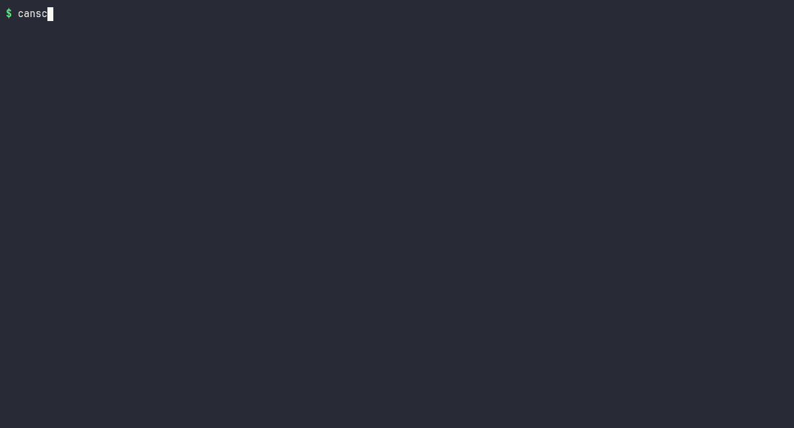

# can-bus-analyzer

Linux SocketCAN analyzer and simulator in C++17: capture, DBC decoding, bus-load statistics, record/replay and DBC-driven traffic generation. No hardware needed to build, test or try it.

[](https://github.com/bekirhankarakurt/can-bus-analyzer/actions/workflows/ci.yml)
[](https://github.com/bekirhankarakurt/can-bus-analyzer/actions/workflows/codeql.yml)
[](https://bekirhankarakurt.github.io/can-bus-analyzer/coverage/)
[](https://github.com/bekirhankarakurt/can-bus-analyzer/releases/latest)
[](LICENSE)
[](https://en.cppreference.com/w/cpp/17)
[-lightgrey.svg)](https://docs.kernel.org/networking/can.html)



**Documentation:** [API reference and coverage report](https://bekirhankarakurt.github.io/can-bus-analyzer/)

## Why / what

- **One tool for the daily bus workflow**: watch, decode, filter, record, replay and load-check a CAN or CAN FD bus from a single binary (`canscan`).
- **DBC-aware**: `BO_`/`SG_` with Intel and Motorola byte order, signed/unsigned, factor/offset, extended IDs and `GenMsgCycleTime`.
- **Hardware optional**: every command also runs on a candump log (`--replay`) or on traffic synthesized from a DBC (`--generate`), so CI and laptops without a CAN adapter are first-class.
- **candump-compatible logs**: recordings open in `can-utils` and vice versa, including CAN FD (`123##1...`) and RTR (`123#R`).
- **Small and strict**: no dependencies beyond the C++17 standard library and Linux headers, RAII throughout, zero warnings under `-Wall -Wextra -Wpedantic -Wshadow -Wconversion`, tested under ASan/UBSan.

## Demo

Real output of `canscan monitor --replay tests/fixtures/sample.log --dbc tests/fixtures/sample.dbc --speed 0`:

```text
(1700000000.000000) vcan0 100#7017826400000000  EngineData  EngineSpeed=1500 rpm  CoolantTemp=90 degC  ThrottlePos=40 %
(1700000000.005000) vcan0 200#FF85303901000000  Chassis  SteeringAngle=-12.3 deg  WheelSpeed=123.45 km/h  BrakePressed=1
(1700000000.010000) vcan0 100#E02E968000000000  EngineData  EngineSpeed=3000 rpm  CoolantTemp=110 degC  ThrottlePos=51.2 %
(1700000000.020000) vcan0 18FEF100#2D  CruiseControl  SetSpeed=45 km/h
(1700000000.025000) vcan0 300##10100000000000000E8FF0000  FdPayload  Counter=1  Delta=-12 m
(1700000000.030000) vcan0 7FF#R
```

`--live` renders the latest value per ID as a refreshing table:

```text
canscan  6 frames  200.0 frames/s  load 4.06 %

ID        Name                 Count  Data
100       EngineData               2  E0 2E 96 80 00 00 00 00
            EngineSpeed=3000 rpm
            CoolantTemp=110 degC
            ThrottlePos=51.2 %
200       Chassis                  1  FF 85 30 39 01 00 00 00
            SteeringAngle=-12.3 deg
            WheelSpeed=123.45 km/h
            BrakePressed=1
300       FdPayload                1  01 00 00 00 00 00 00 00 E8 FF 00 00
            Counter=1
            Delta=-12 m
7FF       -                        1
18FEF100  CruiseControl            1  2D
            SetSpeed=45 km/h
```

`canscan generate tests/fixtures/sample.dbc -n 400 --speed 0 > run.log && canscan stats --replay run.log --speed 0`:

```text
Frames    400 (3368 data bytes) in 2.100 s, 190.5 frames/s
Bus load  4.44 % of 500000 bit/s (estimate, no stuff bits)

ID        Count  Period [ms]
100         211       10.000
200         105       20.000
300          42       50.000
400          21      100.000
18FEF100     21      100.000
```

## Quick start (60 seconds, no hardware)

Prebuilt `linux-x86_64` and `linux-aarch64` binaries are on the [Releases page](https://github.com/bekirhankarakurt/can-bus-analyzer/releases/latest); or build from source:

```bash
git clone https://github.com/bekirhankarakurt/can-bus-analyzer.git && cd can-bus-analyzer
cmake -S . -B build && cmake --build build -j
ctest --test-dir build --output-on-failure
./build/canscan monitor --replay tests/fixtures/sample.log --dbc tests/fixtures/sample.dbc --speed 0
```

With a real or virtual bus (needs root once, `iproute2` and the `vcan` kernel module):

```bash
sudo scripts/setup_vcan.sh                      # creates vcan0 with MTU 72 (CAN FD capable)
./build/canscan generate tests/fixtures/sample.dbc -i vcan0 &   # simulated ECUs
./build/canscan monitor -i vcan0 --dbc tests/fixtures/sample.dbc --live
```

## Requirements and build options

| Requirement | Version |
| --- | --- |
| Linux (SocketCAN headers in `linux/can.h`) | kernel 3.6+ for CAN FD |
| C++17 compiler | GCC 9+ or Clang 10+ |
| CMake | 3.16+ |
| `iproute2`, `vcan` module | only for `scripts/setup_vcan.sh` |

| CMake option | Default | Effect |
| --- | --- | --- |
| `CMAKE_BUILD_TYPE` | `Release` | Standard CMake build type |
| `CANBUS_BUILD_TESTS` | `ON` | Build `canbus_tests` and register it with CTest |
| `CANBUS_SANITIZE` | `OFF` | Build with AddressSanitizer + UBSan |
| `CANBUS_WERROR` | `OFF` | Treat warnings as errors (CI sets this to `ON`) |

## Usage

```text
canscan <command> [options]
```

| Command | Purpose |
| --- | --- |
| `monitor` | Print frames, decoded with `--dbc`; `--live` for a refreshing table |
| `record` | Write frames to a candump-compatible log (`-o FILE`) |
| `stats` | Bus load, frame rate and per-ID period report when the capture ends |
| `replay LOG` | Re-send a log with its original timing to `-i IFACE` (stdout if omitted) |
| `generate DBC` | Synthesize traffic from a DBC to `-i IFACE` (stdout if omitted) |

| Option | Applies to | Description |
| --- | --- | --- |
| `-i`, `--iface IFACE` | all | Capture interface (monitor/record/stats) or output interface (replay/generate) |
| `--replay LOG` | monitor, record, stats | Read frames from a candump log instead of hardware |
| `--generate DBC` | monitor, record, stats | Read frames synthesized from a DBC instead of hardware |
| `--dbc FILE` | all | DBC used to decode signals (defaults to the generator DBC for `--generate`) |
| `-f`, `--filter SPEC` | all | `ID`, `ID:MASK` or `ID~MASK` (reject); hex; repeatable. 8 digits or `> 7FF` = extended |
| `-o`, `--output FILE` | record | Output log |
| `-n`, `--count N` | all | Stop after N accepted frames |
| `-t`, `--duration SEC` | all | Stop after SEC seconds of bus time |
| `--speed X` | log/generator input | Playback speed, default `1`; `0` = as fast as possible |
| `--loop` | replay inputs | Repeat the log endlessly |
| `--live` | monitor | Refreshing table instead of a stream |
| `--bitrate BPS` | monitor, record, stats | Nominal bit rate for the load estimate, default `500000` |

Exit codes: `0` success, `1` runtime error (missing file, no such interface), `2` usage error. `Ctrl-C` stops any running command cleanly.

### Recipes

```bash
# 1. Decode a recording offline, only the engine message
./build/canscan monitor --replay tests/fixtures/sample.log --dbc tests/fixtures/sample.dbc --speed 0 -f 100

# 2. Everything except one chatty ID, first 3 frames
./build/canscan monitor --replay tests/fixtures/sample.log --speed 0 -f 100~7FF -n 3

# 3. Build a 5 s test recording from a DBC, then inspect it
./build/canscan record --generate tests/fixtures/sample.dbc --speed 0 -t 5 -o drive.log
./build/canscan stats --replay drive.log --speed 0 --bitrate 250000

# 4. Capture 30 s from a real bus, powertrain IDs 0x100-0x10F only
./build/canscan record -i can0 -f 100:7F0 -t 30 -o capture.log

# 5. Play a recording back at 2x onto vcan0, endlessly
./build/canscan replay capture.log -i vcan0 --speed 2 --loop
```

## Architecture

```text
 ┌─────────────┐   ┌─────────────┐   ┌─────────────┐
 │  SocketCan  │   │  LogSource  │   │ Generator   │   FrameSource
 │ (vcan/can0) │   │ (candump)   │   │ (from DBC)  │   next() -> Frame | Timeout | End
 └──────┬──────┘   └──────┬──────┘   └──────┬──────┘
        │                 └────────┬────────┘
        │                   PacedSource (real-time, --speed)
        └──────────────┬───────────┘
                  FilterSet (-f)  ──►  pump loop (--count / --duration / Ctrl-C)
                       │
        ┌──────────────┼──────────────┬───────────────┐
     monitor        record          stats         replay/generate
  describe() +    candump line    StatsCollector   FrameSink
   LiveView       to file         + report         SocketCan | StreamSink
        │
   Database (DBC): decode_message / encode_signal
```

Design trade-offs:

- **Sources are polled, not threaded.** `next()` returns `Timeout` every 100 ms on an idle bus, so one loop can honour `Ctrl-C`, `--duration` and filters without locks.
- **Simulation is a source, not a mock.** Replay and generator sit behind the same interface as the socket, so the code path under test is the code path that runs on hardware; only `socketcan.cpp` is untested against a real bus in CI.
- **Pacing is a decorator.** Sources are pure and instant (fast tests); `PacedSource` adds real-time behaviour from frame timestamps.
- **Bus load is an estimate.** Frame bits are counted without stuff bits and CAN FD at the nominal rate, so the figure is a lower bound.
- **Multiplexed DBC signals are skipped** (with a warning) rather than decoded wrongly.
- **Timestamps are userspace receive times** (`system_clock`), not kernel hardware timestamps.

## Formats

candump log line (`candump -L` compatible):

| Frame | Example | Notes |
| --- | --- | --- |
| Classical | `(1700000000.000000) vcan0 123#DEADBEEF` | 3-digit ID |
| Extended | `(1700000000.020000) vcan0 18FEF100#2D` | 8-digit ID |
| CAN FD | `(1700000000.025000) vcan0 300##1<data>` | digit after `##`: `1` = BRS, `2` = ESI |
| RTR | `(1700000000.030000) vcan0 7FF#R` | optional length: `7FF#R4` |

DBC subset:

| Element | Syntax | Handled |
| --- | --- | --- |
| Message | `BO_ <id> <name>: <dlc> <sender>` | Bit 31 of `<id>` marks an extended ID; DLC up to 64 (valid FD sizes) |
| Signal | `SG_ <name> : <start>\|<len>@<order><sign> (<factor>,<offset>) [<min>\|<max>] "<unit>" <rx>` | `@1` Intel / `@0` Motorola, `+` unsigned / `-` signed, 1-64 bits |
| Cycle time | `BA_ "GenMsgCycleTime" BO_ <id> <ms>;` | Generator period (100 ms if absent) |
| Multiplexed signal | `SG_ x m0 : ...` | Skipped with a warning |

Physical value = raw × factor + offset. For big-endian signals `<start>` is the position of the most significant bit.

## Testing

```bash
ctest --test-dir build --output-on-failure              # all suites
./build/tests/canbus_tests dbc                          # one suite: candump dbc filter stats live sources cli
cmake -S . -B build-asan -DCMAKE_BUILD_TYPE=Debug -DCANBUS_SANITIZE=ON && cmake --build build-asan -j && ctest --test-dir build-asan
```

A dependency-free harness (`tests/test_framework.hpp`) drives 7 CTest suites against fixture files in `tests/fixtures/` (`sample.dbc`, `sample.log`): bit-exact signal decoding for both byte orders, encode/decode round trips, log round trip byte-for-byte, filters, load maths, generator determinism and cycle times, pacing and stop handling, and end-to-end CLI runs including error codes. CI runs GCC, Clang, a GCC ASan/UBSan job, cppcheck + clang-tidy, CodeQL and line coverage (published to the [documentation site](https://bekirhankarakurt.github.io/can-bus-analyzer/coverage/)) on every push.

## Troubleshooting / FAQ

| Symptom | Fix |
| --- | --- |
| `cannot find interface 'vcan0'` | Run `sudo scripts/setup_vcan.sh` (needs the `vcan` module and `iproute2`) |
| `cannot open CAN socket: Address family not supported` | The kernel has no CAN support (some containers/VMs). Use `--replay` / `--generate` |
| `send failed ... Invalid argument` on FD frames | Interface MTU is 16; set it to 72: `sudo ip link set vcan0 mtu 72` |
| Bus load looks low compared with a scope | Estimate ignores stuff bits and FD bit-rate switching; see trade-offs |
| `warning: N multiplexed signal(s) ... skipped` | Multiplexing is not implemented; other signals still decode |
| `generating without delay needs --count or --duration` | `generate --speed 0` would never stop; add `-n` or `-t` |
| Piping `monitor` into `grep` shows output late | Output is flushed per frame; use `grep --line-buffered` |

## Project tree

```text
.
├── CMakeLists.txt              # library + canscan + tests, warning/sanitizer options
├── include/canbus/
│   ├── frame.hpp               # CanFrame (classical + FD)
│   ├── candump.hpp             # log line format / parse / read_log
│   ├── dbc.hpp                 # Database, Signal, decode/encode
│   ├── filter.hpp              # ID:MASK filters
│   ├── stats.hpp               # bus-load collector and report
│   ├── live.hpp                # refreshing decoded table
│   ├── source.hpp              # FrameSource/Sink, LogSource, GeneratorSource, PacedSource
│   ├── socketcan.hpp           # SocketCAN socket (RAII)
│   └── cli.hpp                 # run_cli entry point
├── src/                        # implementations + main.cpp
├── tests/                      # harness, suites, fixtures/{sample.dbc,sample.log}
├── scripts/setup_vcan.sh       # create/remove a virtual CAN interface
├── docs/                       # demo.gif and the scripts that record it
├── Doxyfile                    # API documentation
├── .clang-tidy                 # static analysis configuration
├── CHANGELOG.md  CONTRIBUTING.md  SECURITY.md
└── .github/
    ├── workflows/              # ci, codeql, pages (docs + coverage), release
    ├── ISSUE_TEMPLATE/  PULL_REQUEST_TEMPLATE.md  dependabot.yml
```

## Roadmap

- [x] Raw and CAN FD capture, filters
- [x] DBC parser (byte order, sign, scale/offset, extended IDs, cycle times)
- [x] Live decoded signal view and bus-load statistics
- [x] candump-compatible record and timed replay
- [x] Traffic generator from DBC
- [ ] Multiplexed signals
- [ ] DBC value tables (`VAL_`) in decoded output
- [ ] Kernel hardware timestamps
- [ ] Bus-load estimate with stuff bits and FD bit-rate switching

## License

MIT - see [LICENSE](LICENSE).

Bekirhan Karakurt - [github.com/bekirhankarakurt](https://github.com/bekirhankarakurt)
